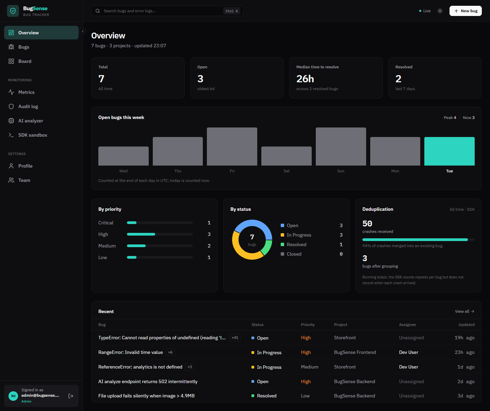
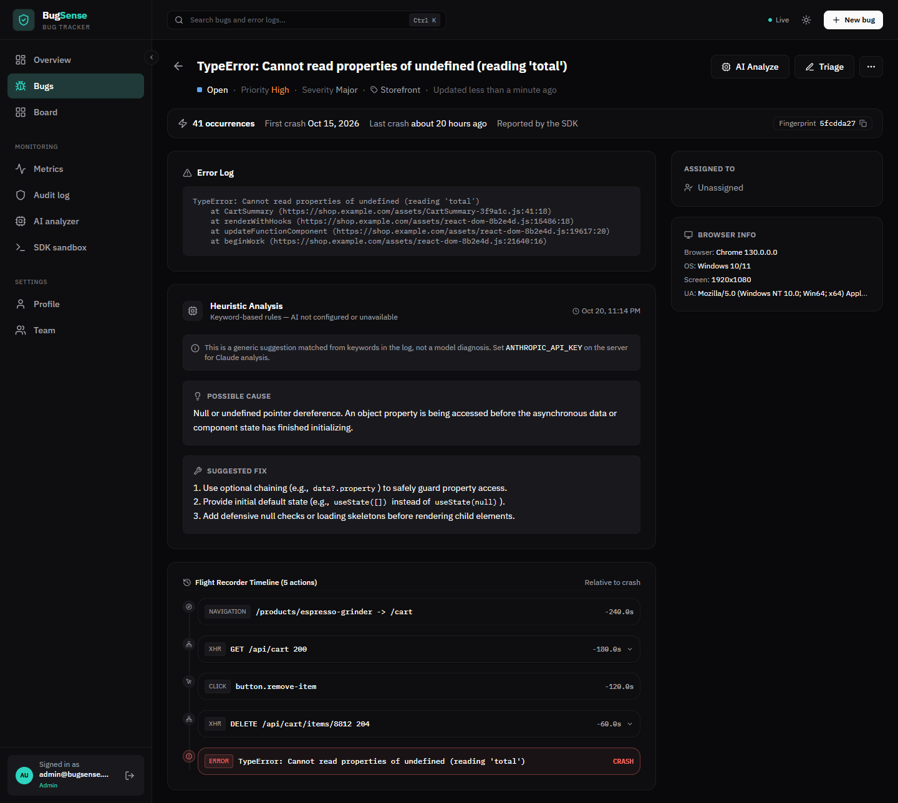
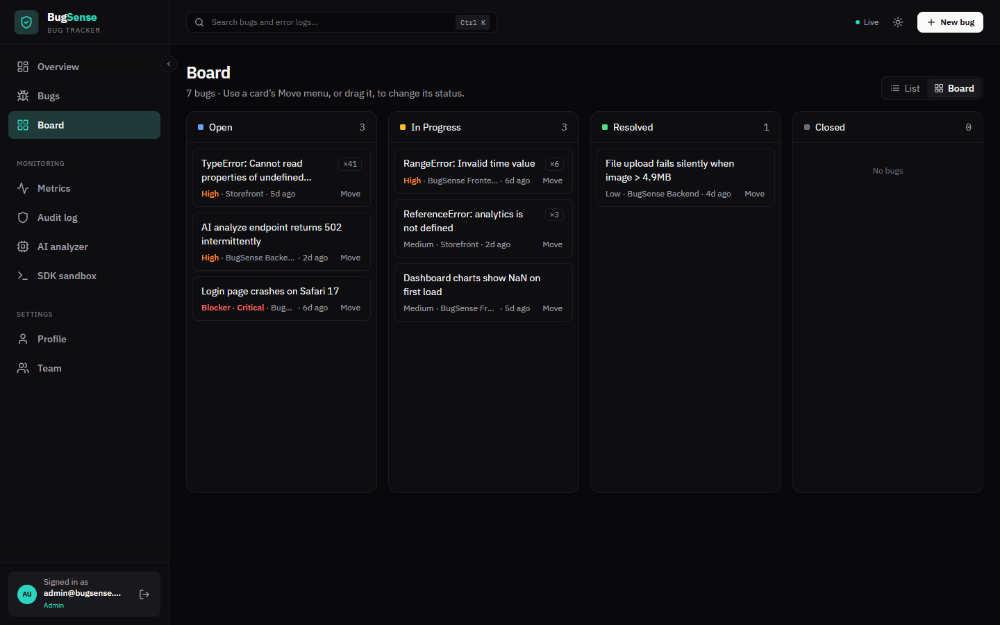
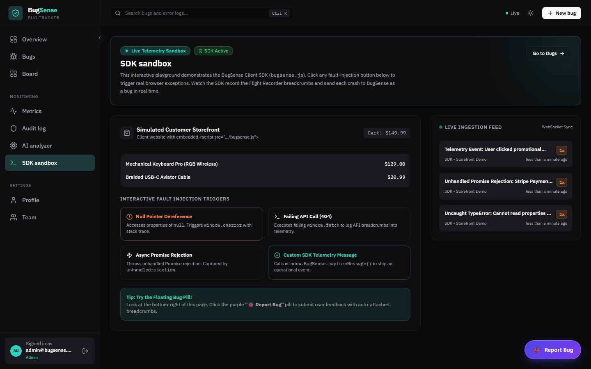

# BugSense — Smart Bug Reporting & AI Debug Assistant

[](https://github.com/krishnendu-9/bugsense/actions)
[](LICENSE)

> A bug tracker with an embeddable crash-reporting SDK — so it also catches the
> bugs nobody gets round to reporting.

Most bug trackers wait for a person to file a report. BugSense does that too —
rich text, numbered reproduction steps, auto-captured browser and OS details,
drag-and-drop screenshots you can mark up — but it also ships `bugsense.js`, a
zero-dependency script you drop into any web app. It captures crashes as they
happen, records the last fifteen things the user did before each one, and
collapses identical stack traces into a single incident with an occurrence
counter.

Reports from people and reports from machines land in the same triage flow: the
same statuses and assignees, the same real-time Kanban board, the same audit
trail, the same Discord and Slack alerts. Claude suggests a likely cause and fix
where a key is configured, and says so plainly when one is not.

React 18 and Vite on the front, Express and MongoDB behind it, Socket.io for
live updates, JWT auth with role-based permissions, and Docker Compose with
nginx to run the lot. Tests are `node:test` with Supertest on the server and
Vitest with React Testing Library on the client, both run by CI.

---

## Run it in two commands

No API keys and no config. The full stack — MongoDB, the Express API and the
React client behind nginx — comes up with two commands. The first run pulls the
MongoDB image (about 300 MB) and builds the app, which takes a few minutes: two
in our tests on a fast connection with Docker already running, longer on a slow
one. After that, `docker compose up` is ready in about 20 seconds.

```bash
git clone https://github.com/krishnendu-9/bugsense.git
cd bugsense
docker compose up --build

# in a second terminal, load 3 demo users, 4 sample bugs and a comment
docker compose exec server npm run seed
```

The server log opens with a `WARNING` that `JWT_SECRET` is a published example
value. That is expected for this local demo; set a real secret before exposing
the stack anywhere ([details](docs/CONFIGURATION.md#docker-the-details)).

The MongoDB container prints its own startup log too, including warnings that
access control is not enabled and hints about XFS and memory tuning; these are
expected for a local demo with no auth on the database.

Then open **http://localhost:8080** and sign in with:

| Role | Email | Password |
|---|---|---|
| Admin | `admin@bugsense.dev` | `password123` |
| Developer | `dev@bugsense.dev` | `password123` |
| Reporter | `reporter@bugsense.dev` | `password123` |

The whole application is explorable with zero configuration. Without
`ANTHROPIC_API_KEY`, root-cause analysis falls back to keyword heuristics and
post-mortems to a data-filled template — both clearly labelled as such in the UI —
and patch generation reports that it is unavailable rather than inventing code.
Add a key to see Claude drive all three.

Prerequisites for running it without Docker: Node.js 22.13+ (22 or 24 LTS) and a
MongoDB, local or Atlas. See
[docs/CONFIGURATION.md](docs/CONFIGURATION.md) for that path.

---

<!-- TODO: add a short walkthrough GIF above the screenshots once the UI work lands -->

## Screenshots

| Dashboard | Bug Detail |
|---|---|
|  |  |

| Kanban Board | SDK Sandbox |
|---|---|
|  |  |

*Screenshots use the seeded demo data plus simulated SDK traffic, with no AI key configured — which is why analyses are labelled "Heuristic".*

---

## Worth reading the code for

**Deduplication.** Incoming stack traces are normalised — UUIDs, memory
addresses, timestamps and line numbers stripped — then hashed with the project
name, so a crash loop becomes one incident with a counter rather than a thousand
rows. Counting uses a single atomic `$inc` behind a unique partial index on
`{fingerprint, source: 'sdk'}`, so simultaneous first reports cannot both create
an incident; the API tests fire eight at once to prove it. How well it actually
does this is measured in
[docs/fingerprint-results.md](docs/fingerprint-results.md) — identical repeats
group reliably, grouping across minified production builds does not. See
[`fingerprint.util.js`](server/utils/fingerprint.util.js).

**The public telemetry endpoint is treated as hostile.**
`/api/telemetry/report` has to accept unauthenticated traffic from other
origins, so it gets its own CORS policy, a 64 KB body limit, per-field length
caps, enum coercion, its own rate limit and an optional shared ingest key.
Because each new crash triggers an AI analysis, those are capped per hour — or
anyone could run up the API bill — and a report cannot claim `critical` priority
or `blocker` severity, since those page every alert channel. See
[`telemetry.controller.js`](server/controllers/telemetry.controller.js).

**AI output always declares its source.** Every result carries a `source` of
`claude`, `heuristic`, `template` or `unavailable`, and the UI labels it, so a
keyword-matched guess is never presented as a model's answer. Without an API key
patch generation returns nothing at all rather than an invented diff: a
plausible-looking fake patch is worse than none. See
[`ai.service.js`](server/services/ai.service.js).

The rest of the decisions, the architecture diagram and the known limitations
are in [docs/ARCHITECTURE.md](docs/ARCHITECTURE.md).

---

## Embedding the SDK

```html
<script
  src="https://your-bugsense-host/sdk/bugsense.js"
  data-api-url="https://your-bugsense-host"
  data-project="My Client App"
  data-key="your-ingest-key"
></script>
```

That one tag auto-reports uncaught errors and unhandled rejections, records the
last fifteen user actions before each crash, and injects a floating "Report Bug"
pill. It never captures typed input and strips query strings from every URL it
reports, including those inside stack traces. It caps itself at 20 reports per
page session and suppresses repeats of the same error within 10 seconds, so a
crash loop in the host page cannot flood the endpoint.

Attributes, manual capture, privacy details and limits: [docs/SDK.md](docs/SDK.md).

---

## Tests

```bash
cd server && npm run lint && npm test      # npm run test:coverage for a report
cd client && npm run lint && npm test      # npm run test:coverage for a report
```

The server suite runs the real middleware stack against an in-memory MongoDB,
covering auth and roles, permissions and triage rules, XSS sanitization, SSRF
protection, telemetry deduplication and escalation limits, alert routing, upload
storage, audit events and socket authentication. The client suite covers
role-gated navigation, forms, dialogs, real-time updates on the bug page, crash
self-reporting and honest AI labelling, plus jsdom tests for the SDK itself. CI
runs all of it, with coverage, on every push. Set `MONGO_URI_TEST` to run the
server tests against an existing MongoDB instead — use a dedicated database, as
the suite drops it.

---

## Documentation

| Document | What is in it |
|---|---|
| [docs/ARCHITECTURE.md](docs/ARCHITECTURE.md) | How the pieces fit together, the engineering decisions behind them, and known limitations |
| [docs/API.md](docs/API.md) | Every REST endpoint, with auth and roles |
| [docs/CONFIGURATION.md](docs/CONFIGURATION.md) | Every environment variable, Docker details, running locally with Node, and deploying |
| [docs/SDK.md](docs/SDK.md) | Embedding `bugsense.js` in another app: attributes, manual capture, privacy and limits |

---

## License

[MIT](LICENSE) © 2026 Krishnendu Ghosh
