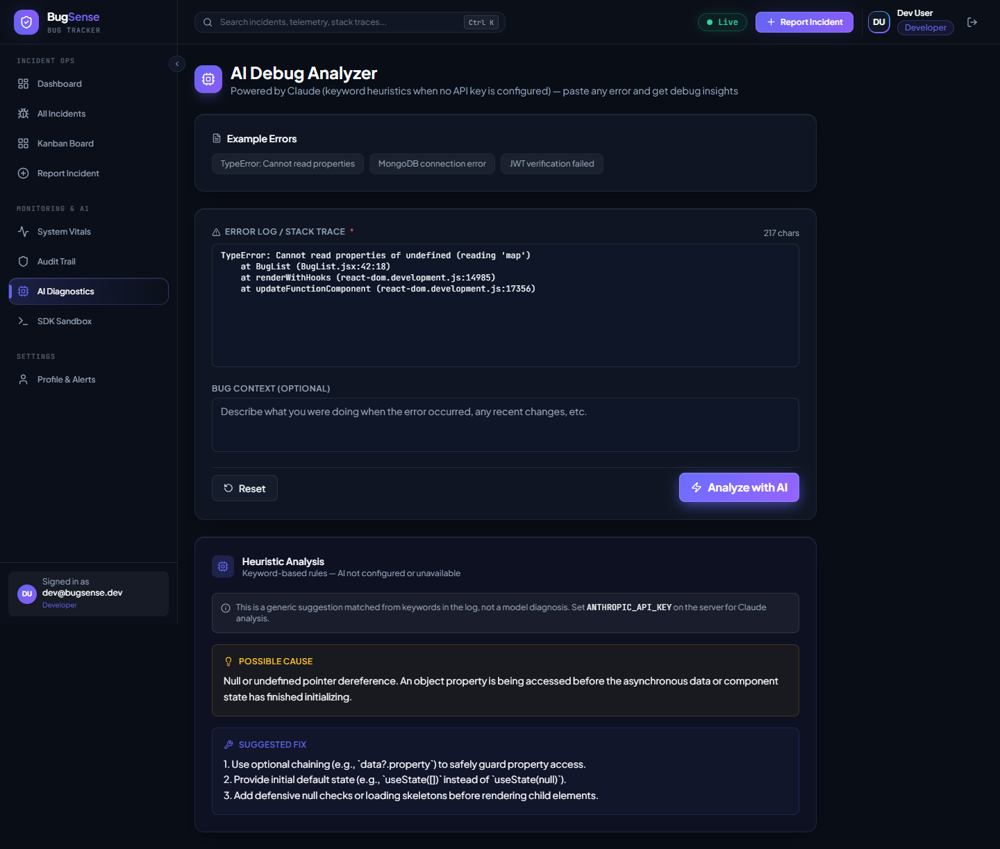
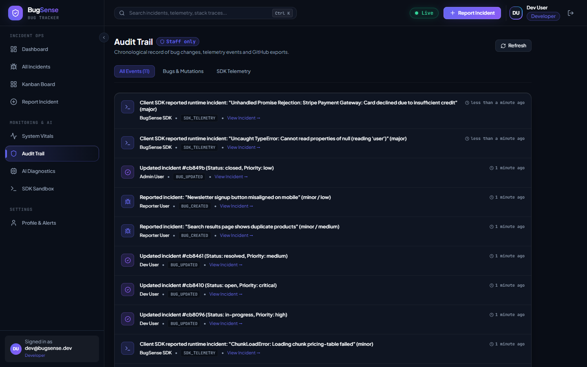
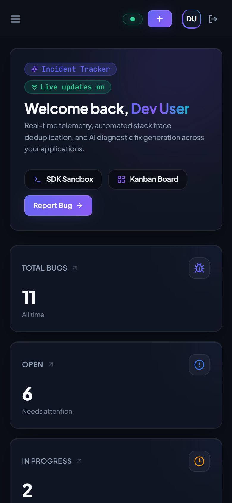
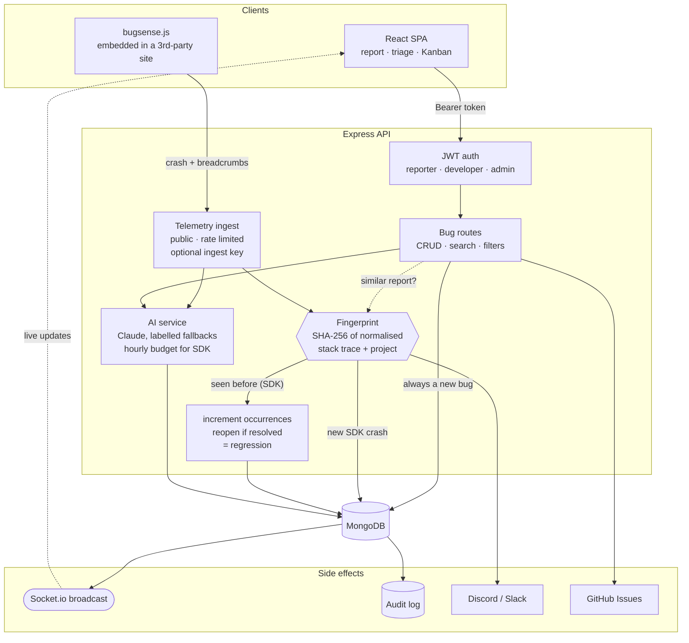

# BugSense — Smart Bug Reporting & AI Debug Assistant

[](https://github.com/krishnendu-9/bugsense/actions)


> A MERN-stack bug tracker that turns vague bug reports into structured, reproducible ones — with an embeddable crash-reporting SDK, real-time collaboration and AI-assisted debugging.

---

## Run it in 60 seconds

No API keys and no config. The full stack — MongoDB, the Express API and the
React client behind nginx — comes up with two commands:

```bash
git clone https://github.com/krishnendu-9/bugsense.git
cd bugsense
docker compose up --build

# in a second terminal, load 3 demo users and 4 sample bugs
docker compose exec server npm run seed
```

Then open **http://localhost:5173** and sign in with:

| Role | Email | Password |
|---|---|---|
| Admin | `admin@bugsense.dev` | `password123` |
| Developer | `dev@bugsense.dev` | `password123` |
| Reporter | `reporter@bugsense.dev` | `password123` |

The whole application is explorable with zero configuration. Without
`ANTHROPIC_API_KEY`, root-cause analysis falls back to keyword heuristics and
post-mortems to a data-filled template — both clearly labelled as such in the UI —
and patch generation reports that it is unavailable rather than inventing code.
Add a key to see Claude drive all three.

---

## Screenshots

| Dashboard | Kanban Board |
|---|---|
|  |  |

| Bug Detail | AI Diagnostics |
|---|---|
|  |  |

| SDK Sandbox | Audit Trail |
|---|---|
|  |  |

<p align="center"></p>

*Screenshots use the seeded demo data plus simulated SDK traffic, with no AI key configured — which is why analyses are labelled "Heuristic".*

---

## Why I Built This

Bug reports are the worst part of software development — not because bugs exist, but because reports are incomplete. Developers waste hours asking "what browser?", "what error?", "can you reproduce it?". BugSense removes most of that back-and-forth: it auto-captures browser context, guides reporters through structured reproduction steps, records what a user did before a crash, and uses AI to suggest a likely cause and fix.

---

## Features

- **One-Click CSV & JSON Data Export** — Export every incident matching the current filters to CSV (formula-injection safe) or JSON
- **In-App Webhook Settings & Live Test Ping** — Each user configures their own Discord/Slack webhooks with alert preferences (new critical/blocker incidents, regressions) and a 1-click test ping
- **Live System Vitals & Health Metrics (`/metrics`, staff only)** — Real-time Node.js process heap, MongoDB connectivity status, uptime counters, and telemetry deduplication efficiency analytics
- **Audit Trail (`/audit`, staff only)** — Paginated activity log of bug changes, telemetry incidents and regressions, comments, sign-ups, failed sign-ins, password and role changes, and GitHub exports
- **Team Management (`/team`, admins only)** — Promote reporters to developers or admins; developer self-sign-up is an explicit per-deployment choice (`ALLOW_DEVELOPER_SIGNUP`)
- **Embeddable Client SDK (`bugsense.js`)** — Zero-dependency agent any web app can install to auto-capture crashes and inject an in-app bug report pill; never records typed input, strips query strings from URLs, and can be torn down with `BugSense.destroy()`
- **Flight Recorder Breadcrumbs** — Automatically records the user's last 15 actions (DOM clicks, page navigation including `replaceState`, `fetch` *and* `XMLHttpRequest`/axios calls, and console errors) leading up to an incident
- **Self-Monitoring** — The dashboard reports its own render crashes to its own telemetry endpoint (project "BugSense Dashboard"), and a crash in one page leaves the rest of the app usable
- **Error Fingerprinting & Deduplication** — Deterministic SHA-256 stack trace hashing groups recurring SDK errors with atomic, race-safe occurrence counters (e.g. `42x occurrences`) and flags regressions; manual reports are never merged, but similar existing reports are pointed out
- **AI Pull Request & Patch Generator** — Claude proposes unified Git diffs with syntax highlighting and copyable `git apply` commands (requires an API key); the patch is saved on the bug and reopened without another model call until you choose Regenerate
- **Interactive SDK Sandbox (`/sdk-demo`)** — Built-in simulated customer storefront allowing developers to inject real-world browser exceptions, failing API calls, and async rejections to demonstrate live telemetry ingestion
- **AI Incident Post-Mortem Generator** — Formal engineering post-mortem synthesis in GitHub-flavored Markdown covering Executive Summary, Breadcrumb Timeline, RCA, and Action Items with 1-click `.md` download
- **Real-Time Kanban Workflow Board (`/board`)** — Linear-style collaborative issue board featuring quick stage shifts (`Open`, `In Progress`, `Resolved`, `Closed`) synchronized via Socket.io
- **GitHub Issues 1-Click Export** — Convert any bug report into an official GitHub Issue via GitHub REST API with stack traces and AI diagnostics attached; the server's token only works for allowlisted repositories
- **Discord & Slack Webhooks** — Alerts for critical/blocker and regressed incidents, sent only to genuine Discord/Slack webhook URLs
- **Structured Bug Reporting** — Rich text descriptions, numbered reproduction steps, auto-captured browser/OS metadata; details stay editable after filing, and the error log is analysed in the background so submitting never waits on the AI
- **Clear Triage Rules** — Staff move bugs through the whole workflow; a reporter can close their own bug or reopen it, and the UI, Kanban board and API enforce the same rule
- **Screenshot Uploads & Fabric.js Markup** — Drag-and-drop screenshot upload with canvas markup (pencil, lines, rectangles, ellipses)
- **Real-Time Collaboration** — Authenticated Socket.io live updates for status changes, assignments, new incidents, and comments
- **AI-Powered Diagnostics** — Claude diagnoses root causes and suggests actionable fix steps; offline heuristic results are labelled as heuristics
- **Profile & Settings** — Manage display names, avatar uploads, and bcrypt password changes that sign out every other session
- **Security** — Server- and client-side HTML sanitization, role-based access control on every mutating route, authenticated WebSockets, SSRF-safe webhooks, optional SDK ingest key, multi-tier rate limiting, and Helmet headers
- **Developer Dashboard** — Recharts metrics, priority distributions, and recent incident streams
- **Responsive Dark UI** — Tailwind design tokens, skeleton loading states, accessible dialogs (Escape, focus trap, focus return), a mobile navigation drawer, and route-level code splitting (~130 kB gzipped first load)

---

## Tech Stack

| Layer | Technology |
|-------|-----------|
| Frontend Framework | React 18 (Vite) |
| Styling | Tailwind CSS v3 |
| Routing | React Router v7 |
| HTTP Client | Axios |
| Forms | React Hook Form |
| Rich Text | React Quill (react-quill-new) + DOMPurify |
| Canvas Annotations | Fabric.js |
| Icons | Lucide React |
| Charts | Recharts |
| Notifications | React Hot Toast |
| Date Formatting | date-fns |
| Backend | Node.js + Express.js |
| Database | MongoDB + Mongoose |
| Authentication | JWT + bcryptjs |
| File Uploads | Multer |
| Validation & Sanitization | express-validator, sanitize-html |
| Real-time | Socket.io (server + client) |
| Security | Helmet, CORS, express-rate-limit |
| AI | Anthropic SDK (Claude Sonnet) |
| Logging | Morgan |
| Linting | ESLint 9 (flat config, both packages) |
| Containers | Docker + Docker Compose + nginx |
| Testing | node:test + Supertest + mongodb-memory-server (API), Vitest + React Testing Library (client) |
| CI | GitHub Actions (lint, tests, build, image builds) |

---

## Architecture

Two ways in: a human filing a structured report, or an SDK in someone else's app
reporting a crash automatically. Both are fingerprinted, but only SDK crashes are
deduplicated — a person's report is always kept, with a "looks similar" hint.
Every write fans back out over authenticated WebSockets.



**The part worth reading the code for** is the fingerprint step. Incoming stack
traces are normalised — UUIDs, memory addresses, timestamps and line numbers
stripped — then hashed with the project name. Identical SDK crashes collapse into
one incident with an occurrence counter instead of a thousand duplicate rows, and
a crash that reappears after being marked resolved is automatically flagged as a
regression. See [`fingerprint.util.js`](server/utils/fingerprint.util.js) and
[`telemetry.controller.js`](server/controllers/telemetry.controller.js).

---

## Engineering Decisions

The choices below shaped the code most. Each one records what was done, why, and
what it costs.

**Only machine reports are deduplicated.** Merging two SDK crashes loses nothing,
because they're the same stack trace. Merging two *human* reports throws away
someone's description and steps, so manual reports are always kept and the
reporter is shown the similar incident instead.

**Deduplication is race-safe by construction.** A crash loop can send many
identical reports at once. Counting uses a single atomic `$inc`, and a unique
partial index on `{fingerprint, source: 'sdk'}` means two simultaneous "first"
reports can't both create an incident — the loser gets a duplicate-key error and
is retried as a repeat. A regression is flipped with one conditional update, so
it's recorded exactly once. The API tests fire eight reports concurrently to
prove it.

**Rich text is sanitised twice.** Descriptions are cleaned with `sanitize-html` on
write and with DOMPurify before rendering. The server copy protects every
consumer of the API; the client copy also covers records stored before
sanitising existed. This matters more than usual because the JWT lives in
`localStorage` (a project requirement): any script injection could read it. An
`httpOnly` cookie would be the stronger choice in a real deployment.

**Sessions can be revoked.** Each user has a `tokenVersion` embedded in their JWT.
Changing a password increments it, which invalidates every other session
immediately without keeping a server-side token list.

**The public endpoint is treated as hostile.** `/api/telemetry/report` must accept
unauthenticated traffic from other origins, so it has its own CORS policy, a
64 KB body limit, per-field length caps, enum coercion, its own rate limit and an
optional shared ingest key. Each new crash triggers an AI analysis, so those are
capped per hour — otherwise anyone could run up the API bill. Reports cannot claim
`critical` priority or `blocker` severity either: those page every alert channel,
so an SDK report tops out at high/major and staff escalate it after triage.

**Nothing waits on the model.** Filing a bug with an error log returns at once;
the analysis runs in the background (with its own hourly budget) and arrives on
the bug page over the socket. A generated patch is saved and reopened for free,
and only regenerated on request.

**AI output always says where it came from.** Every result carries `source`
(`claude`, `heuristic`, `template` or `unavailable`) and the UI labels it. Without
an API key, patch generation returns nothing rather than an invented diff: a
plausible-looking fake patch is worse than none.

**Two payload shapes, both populated.** Viewers of a bug receive the same fully
populated document as `GET /bugs/:id`, so they can replace their copy without
losing names or history. Everyone else gets the slim list shape that `GET /bugs`
returns — a crash loop re-broadcasts its bug on every occurrence, and each copy
would otherwise carry the full error log and breadcrumbs to every open tab.
Sockets require the same JWT as the REST API.

**Permissions live on the server; the UI mirrors them.** Every mutating route checks
the role or ownership (`authorize()`, `canModifyBug()`, `canSetStatus()`); the
client hides controls the user can't use, but never relies on that for security.
Being staff is a deliberate grant: developer self-sign-up is off in production
unless `ALLOW_DEVELOPER_SIGNUP=true`, and the server's GitHub token only files
issues in repositories listed in `GITHUB_ALLOWED_REPOS`.

**Unsafe configuration fails loudly.** In production the server refuses to start
with a missing, published or short `JWT_SECRET`. The Docker quick start runs with
a public demo secret only because it sets `ALLOW_INSECURE_JWT_SECRET=true`, and
the server prints a warning banner when it does.

**Testable by design.** The Express app is built by `createApp()` in `app.js`,
separate from the process that listens and connects to the database, so the API
tests run the real middleware stack against an in-memory MongoDB.

### Known limitations

- Uploads default to the server's local disk, which hosts like Render and Railway
  wipe on every redeploy. Set `CLOUDINARY_URL` to keep them in Cloudinary instead.
- The AI budgets and rate limits are per process, not shared across instances
  (a Redis store would fix this).
- Search is a case-insensitive substring match, so "saf" finds "Safari" as you
  type, but it scans rather than using an index. Queries are capped at 5 seconds;
  at real scale this would move to Atlas Search (a plain MongoDB text index only
  matches whole words).
- Single workspace: every signed-in user can see every bug.
- No email verification or password reset flow.

---

## Project Structure

```
bugsense/
├── .github/workflows/        # CI: lint, tests, build, docker image builds
├── docker-compose.yml        # Full stack: MongoDB + API + nginx client
├── client/                   # React frontend (Vite)
│   ├── eslint.config.js
│   ├── nginx.conf            # Proxies /api, /uploads, /sdk, /socket.io
│   ├── vercel.json           # SPA rewrites + asset caching for Vercel
│   ├── Dockerfile
│   └── src/
│       ├── api/              # Axios instance with auth interceptor
│       ├── components/
│       │   ├── ai/           # ErrorInsights, GitPatchModal, PostMortemModal
│       │   ├── bugs/         # BugCard, BugForm, BugFilters, StepsReproducer,
│       │   │                 # AnnotationCanvas, BreadcrumbTimeline,
│       │   │                 # EditBugModal, GitHubExportModal
│       │   ├── common/       # Navbar, Sidebar, Loader, Badge, ProtectedRoute,
│       │   │                 # ErrorBoundary, RoleRoute, Modal, ConfirmDialog
│       │   └── dashboard/    # StatsCard, BugChart, RecentBugs
│       ├── context/          # AuthContext, SocketContext (providers), contexts.js
│       ├── hooks/            # useAuth, useBugs, useAI, useSocket, useDebouncedValue
│       ├── pages/            # auth/, bugs/ (list, detail, report, kanban),
│       │                     # dashboard/, ai/, audit/, metrics/,
│       │                     # playground/, profile/, admin/ (Team)
│       ├── test/             # Test helpers + SDK tests (jsdom)
│       └── utils/            # constants, helpers, selfReport
└── server/                   # Express backend
    ├── eslint.config.js
    ├── Dockerfile
    ├── app.js                # Express app (imported by server.js and the tests)
    ├── server.js             # Entry point: DB connection, HTTP + Socket.io server
    ├── config/               # MongoDB, Socket.io
    ├── controllers/          # auth, bug, comment, ai, user, telemetry, audit
    ├── middleware/           # auth, upload, rateLimit, error
    ├── models/               # User, Bug, Comment, AuditLog
    ├── public/sdk/           # bugsense.js — the embeddable client SDK
    ├── routes/               # auth, bugs, comments, ai, users, telemetry, audit
    ├── scripts/              # seed.js
    ├── services/             # ai, autoAnalysis, token, audit, webhook,
    │                         # bugEvents, storage (disk / Cloudinary)
    ├── tests/                # node:test + Supertest API and unit tests
    ├── utils/                # fingerprint, sanitize, permissions, webhookUrl,
    │                         # uploads, aiBudget, clientOrigins, trustProxy
    └── uploads/              # Multer file storage
```

---

## Setup & Installation

### Prerequisites

- Node.js 20+
- MongoDB (local or Atlas)
- Anthropic API key (optional — AI features degrade gracefully without it)

### 1. Clone the repository

```bash
git clone https://github.com/krishnendu-9/bugsense.git
cd bugsense
```

### 2a. Run with Docker (fastest)

Run the full stack (MongoDB, Express API, and Nginx React Client) with a single command:

```bash
cp .env.example .env    # optional: add ANTHROPIC_API_KEY and a real JWT_SECRET
docker compose up --build
```

- App (and API under `/api`): [http://localhost:5173](http://localhost:5173)

The client image is built with `VITE_API_URL=/api`, so all browser traffic goes
through nginx, which proxies `/api`, `/uploads`, `/sdk` and `/socket.io`
to the server container. Neither the server nor MongoDB is published on a host
port, so a MongoDB already installed on your machine does not get in the way.
The API waits for MongoDB's healthcheck, runs as the unprivileged `node` user,
and has its own healthcheck.

To inspect the database with MongoDB Compass or `mongosh`, publish it on a spare
loopback port with a `docker-compose.override.yml` next to `docker-compose.yml`
(compose picks it up automatically, and it is gitignored):

```yaml
services:
  mongodb:
    ports:
      - "127.0.0.1:27018:27017"   # loopback only: the database has no auth
```

Then connect to `mongodb://localhost:27018/bugsense`. Port 27018 avoids a clash
with a local MongoDB on 27017.

The server runs with `NODE_ENV=production`. With no `JWT_SECRET` in `.env`, it
falls back to a public demo secret and starts only because compose sets
`ALLOW_INSECURE_JWT_SECRET=true` — it prints a warning banner saying so. Before
exposing the stack anywhere, set `JWT_SECRET` (`openssl rand -hex 32`) and
`ALLOW_INSECURE_JWT_SECRET=false` in `.env`.

---

### 2b. Or run locally with Node.js

```bash
cd server
npm install
cp .env.example .env
```

Edit `server/.env`:

```env
PORT=5000
MONGO_URI=mongodb://localhost:27017/bugsense
JWT_SECRET=your_super_secret_jwt_key_here
ANTHROPIC_API_KEY=sk-ant-...
CLIENT_URL=http://localhost:5173
```

Start the backend:

```bash
npm run dev
```

### 3. Frontend setup

```bash
cd client
npm install
```

Create `client/.env`:

```env
VITE_API_URL=http://localhost:5000/api
```

Start the frontend:

```bash
npm run dev
```

### 4. Seed demo data (optional)

```bash
cd server
npm run seed
```

Creates three demo accounts and four sample bugs. Seeding **deletes all data**, so it
refuses to run on a database that already has users; use `npm run seed:reset` to
wipe and reseed deliberately.

### 5. Lint & test

Both packages are linted with ESLint (flat config). The server has an API test
suite (Node's built-in test runner + Supertest) that runs against an in-memory
MongoDB, covering auth and roles, permissions and triage rules, XSS
sanitization, SSRF protection, telemetry deduplication and escalation limits,
alert routing, upload storage (disk and a stubbed Cloudinary), audit events and
socket authentication and payloads. The client has component and utility tests
(Vitest + React Testing Library) for role-gated navigation, forms, dialogs,
real-time updates on the bug page, crash self-reporting and honest AI labelling,
plus jsdom tests for the embeddable SDK. CI runs all of it, with coverage, on
every push.

```bash
cd server && npm run lint && npm test      # npm run test:coverage for a report
cd client && npm run lint && npm test      # npm run test:coverage for a report
```

Set `MONGO_URI_TEST` to run the tests against an existing MongoDB instead
(use a dedicated database — the suite drops it).

### 6. Open in browser

Navigate to [http://localhost:5173](http://localhost:5173)

### 7. Deploying (API on Render/Railway, client on Vercel)

**API** — deploy `server/` (the Dockerfile works as-is, or `npm start`) and set:

| Variable | Value |
|---|---|
| `NODE_ENV` | `production` |
| `MONGO_URI` | your Atlas connection string |
| `JWT_SECRET` | `openssl rand -hex 32` |
| `CLIENT_URL` | your Vercel URL(s), comma-separated |
| `CLOUDINARY_URL` | needed: these hosts wipe local disk on every deploy |
| `TRUST_PROXY` | `1` (one platform proxy in front) |
| `ALLOW_DEVELOPER_SIGNUP` | `true` only if visitors should be able to try staff features |

Optional: `ANTHROPIC_API_KEY`, `TELEMETRY_ALLOWED_ORIGINS`, `GITHUB_TOKEN` with
`GITHUB_ALLOWED_REPOS`, and alert webhooks. Seed the demo accounts once with
`npm run seed` from the service's shell.

**Client** — import `client/` into Vercel (framework: Vite) and set
`VITE_API_URL=https://<your-api-host>/api` (plus `VITE_TELEMETRY_INGEST_KEY` if you
set an ingest key). `client/vercel.json` already rewrites deep links such as
`/bugs/:id` to the SPA and caches hashed assets.

---

## API Endpoints

### Authentication `/api/auth`

| Method | Endpoint | Description | Auth |
|--------|----------|-------------|------|
| GET | `/config` | Public sign-up settings: `{ developerSignup }` | — |
| POST | `/register` | Register new user (`role: developer` only when developer sign-up is allowed) | — |
| POST | `/login` | Login, returns JWT | — |
| GET | `/me` | Get current user | Bearer |

### Bugs `/api/bugs`

| Method | Endpoint | Description | Auth |
|--------|----------|-------------|------|
| GET | `/` | List bugs (filter: `status`, `priority`, `assignedTo`, `reporter`, `project`, `search`, `page`, `limit`) | Bearer |
| POST | `/` | Create bug; returns `analysisQueued` when the error log is being analysed in the background | Bearer |
| GET | `/stats` | Dashboard statistics | Bearer |
| GET | `/github-config` | Repositories the server's GitHub token may file issues in | Staff |
| GET | `/:id` | Single bug with comments | Bearer |
| PUT | `/:id` | Update bug (whitelisted, validated fields). Reporters may edit their bug's content and close/reopen it; status workflow, priority and assignment are staff-only | Bug reporter / Staff |
| DELETE | `/:id` | Delete bug | Admin only |
| POST | `/:id/screenshot` | Upload screenshot (multipart `screenshot`) | Bug reporter / Staff |
| POST | `/:id/annotation` | Upload annotated screenshot (multipart `annotation`) | Bug reporter / Staff |
| POST | `/:id/github` | Export bug as a GitHub Issue (the server token only for `GITHUB_ALLOWED_REPOS`; otherwise send `githubToken`) | Staff |

### Comments `/api/comments`

| Method | Endpoint | Description | Auth |
|--------|----------|-------------|------|
| POST | `/` | Add comment | Bearer |
| GET | `/bug/:bugId` | Get comments for a bug | Bearer |
| DELETE | `/:id` | Delete comment | Author/Admin |

### AI `/api/ai`

| Method | Endpoint | Body | Returns | Auth |
|--------|----------|------|---------|------|
| POST | `/analyze` | `{ errorLog, bugContext?, bugId? }` | `{ possibleCause, suggestedFix, source }` | Bearer |
| POST | `/generate-patch` | `{ bugId?, errorLog?, bugDescription?, steps? }` | `{ diff, explanation, source, generatedAt }` | Bearer |
| POST | `/post-mortem` | `{ bugId }` | `{ markdown, source, generatedAt }` | Bearer |

`source` says what produced the result: `claude`, or without an API key `heuristic` (analysis), `template` (post-mortem) or `unavailable` (patch — the `diff` is empty). Passing `bugId` saves the result on that bug, which requires permission to edit it.

### Users `/api/users`

| Method | Endpoint | Description | Auth |
|--------|----------|-------------|------|
| GET | `/` | Every account, for the Team page | Admin only |
| PUT | `/:id/role` | Change a user's role (`reporter`, `developer`, `admin`); not your own | Admin only |
| GET | `/assignable` | Developers and admins a bug can be assigned to | Staff |
| GET | `/profile` | Get current user profile | Bearer |
| PUT | `/profile` | Update name / change password (returns a fresh token; other sessions are revoked) | Bearer |
| POST | `/avatar` | Upload profile avatar | Bearer |
| PUT | `/webhooks` | Save Discord/Slack webhook settings | Bearer |
| POST | `/webhooks/test` | Send a test alert to a webhook | Bearer |

### Telemetry `/api/telemetry`

| Method | Endpoint | Description | Auth |
|--------|----------|-------------|------|
| POST | `/report` | SDK crash/feedback ingestion with fingerprint deduplication | Public, rate limited; `X-BugSense-Key` when `TELEMETRY_INGEST_KEY` is set |

### Audit `/api/audit`

| Method | Endpoint | Description | Auth |
|--------|----------|-------------|------|
| GET | `/` | Paginated activity log (filter: `entityType`, `action`) | Staff |

### Health `/api/health`

| Method | Endpoint | Description | Auth |
|--------|----------|-------------|------|
| GET | `/` | Liveness probe | — |
| GET | `/metrics` | Uptime, heap, Mongo status, dedup efficiency | Staff |

*Staff* means the `developer` or `admin` role. Sockets require the same JWT, passed as `auth.token` in the Socket.io handshake.

---

## Embedding the Client SDK

`bugsense.js` is a zero-dependency agent any web app can drop in. It records the
last 15 user actions (clicks, `pushState`/`replaceState` navigation, `fetch` and
`XMLHttpRequest` calls — so axios traffic is included — and console errors),
auto-reports uncaught errors and unhandled rejections, and injects a floating
"Report Bug" widget. Reports can set priority up to `high` and severity up to
`major`; escalation to critical/blocker is left to staff.

```html
<script
  src="https://your-bugsense-host/sdk/bugsense.js"
  data-api-url="https://your-bugsense-host"
  data-project="My Client App"
  data-key="your-ingest-key"
></script>
```

| Attribute | Default | Description |
|-----------|---------|-------------|
| `data-api-url` | `http://localhost:5000` | Base URL of the BugSense API |
| `data-project` | `Production Web App` | Project name recorded on every incident |
| `data-widget` | `true` | Set to `"false"` to suppress the floating report pill |
| `data-key` | — | Ingest key, required when the server sets `TELEMETRY_INGEST_KEY`. It is visible in your page, so treat it as an identifier; `TELEMETRY_ALLOWED_ORIGINS` is what restricts who can report |

Manual capture:

```js
window.BugSense.captureError(err, 'Checkout failed');
window.BugSense.captureMessage('Coupon banner clicked', 'low');
window.BugSense.addBreadcrumb('click', 'User opened the cart drawer');
window.BugSense.destroy(); // restore patched globals and remove the widget
```

**Privacy:** the SDK never records form field values or text from inputs,
textareas, selects, contenteditable regions, or anything inside an element
marked `data-bugsense-mask`. Query strings and fragments are stripped from every
reported URL, including those inside stack traces.

The SDK caps itself at 20 reports per page session and suppresses repeats of the
same error within 10 seconds, so a crash loop in the host page cannot flood the
ingestion endpoint. Try it live at `/sdk-demo`.

---

## Environment Variables Reference

### server/.env

| Variable | Required | Description |
|----------|----------|-------------|
| `PORT` | no | Server port (default: 5000) |
| `MONGO_URI` | no | MongoDB connection string (defaults to `mongodb://localhost:27017/bugsense`) |
| `JWT_SECRET` | in production | Secret key for JWT signing. In production the server refuses to start if it is missing, a published example value, or shorter than 32 characters. Generate one with `openssl rand -hex 32` |
| `ALLOW_INSECURE_JWT_SECRET` | no | `true` lets production start with a weak `JWT_SECRET` (with a warning banner). Only the Docker local demo sets this |
| `NODE_ENV` | no | Set to `production` to enforce the JWT check, production rate limits and the developer sign-up default |
| `CLIENT_URL` | no | Dashboard origin(s), comma-separated (e.g. production plus a Vercel preview). All pass CORS and the socket handshake; the first is used for links in alerts and GitHub issues |
| `TRUST_PROXY` | no | Express `trust proxy`: number of proxy hops (default `1`), `true`/`false`, or addresses. Use `0` when the API is reached directly, otherwise clients can spoof their IP past the rate limits |
| `ANTHROPIC_API_KEY` | no | Anthropic API key. Without it, AI features fall back to clearly labelled heuristics and templates |
| `REPORT_AI_HOURLY_BUDGET` | no | Max background analyses of new manual reports per hour (default: 100) |
| `ALLOW_DEVELOPER_SIGNUP` | no | `true`/`false`: may visitors sign up as developers? Unset = allowed in development, refused in production (admins promote people on the Team page) |
| `CLOUDINARY_URL` | no | `cloudinary://<key>:<secret>@<cloud>`. When set, screenshots, annotations and avatars are stored in Cloudinary instead of local disk (needed on hosts with ephemeral disks, like Render and Railway) |
| `CLOUDINARY_FOLDER` | no | Cloudinary folder for uploads (default: `bugsense`). Only files inside it are ever deleted |
| `UPLOADS_DIR` | no | Local upload directory (default: `server/uploads`) |
| `GITHUB_TOKEN` | no | Server token for GitHub Issue export. Users can always supply their own token per request instead |
| `GITHUB_ALLOWED_REPOS` | with `GITHUB_TOKEN` | Comma-separated `owner/repo` list the server token may file issues in; offered as one-click choices in the export dialog |
| `DISCORD_WEBHOOK_URL` | no | Workspace Discord channel for alerts (critical/blocker incidents and regressions) |
| `SLACK_WEBHOOK_URL` | no | Workspace Slack channel for the same alerts |
| `TELEMETRY_INGEST_KEY` | no | Key the SDK must send (`data-key`). It ships in page HTML, so it is not a secret; unset = open ingestion, fine for local demos |
| `TELEMETRY_ALLOWED_ORIGINS` | no | Comma-separated origins allowed to post telemetry (default: any). This is what actually limits who can report; include the dashboard's own origin, since it reports its own crashes |
| `TELEMETRY_AI_HOURLY_BUDGET` | no | Max background AI analyses started by public telemetry per hour (default: 20) |

### client/.env

| Variable | Description |
|----------|-------------|
| `VITE_API_URL` | Backend API base URL — absolute (`https://api.example.com/api`) or relative (`/api`). Sockets and uploads use the same origin |
| `VITE_TELEMETRY_INGEST_KEY` | Same value as the server's `TELEMETRY_INGEST_KEY`, if set, so the SDK Playground and the dashboard's own crash reports are accepted |
| `VITE_SELF_REPORT` | `false` stops the dashboard reporting its own crashes (on by default in production builds); `true` enables it in development |

---

## Design System

Built on a consistent dark theme with glass morphism cards:

- **Primary:** `#6366F1` (Indigo)
- **Secondary:** `#8B5CF6` (Purple)
- **Background:** `#090D16` (Near-black navy)
- **Surface:** `#111827` (Dark slate)
- **Cards:** `bg-white/5 backdrop-blur border border-white/10`

---

## License

MIT
