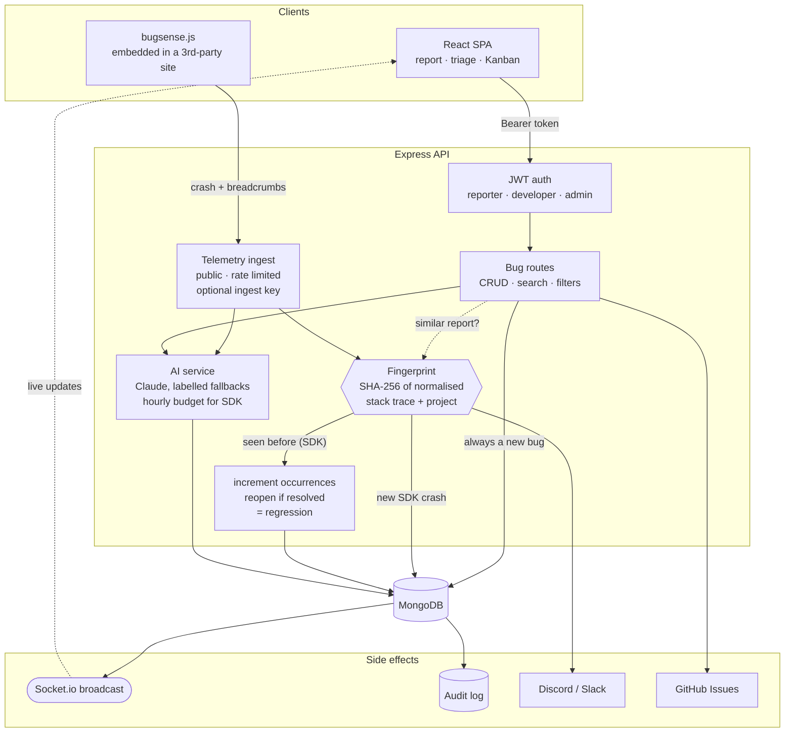

# Architecture & Engineering Decisions

How the pieces fit together, the decisions that shaped the code, and what it
does not do well.

---

## Architecture

Two ways in: a human filing a structured report, or an SDK in someone else's app
reporting a crash automatically. Both are fingerprinted, but only SDK crashes are
deduplicated — a person's report is always kept, with a "looks similar" hint.
Every write fans back out over authenticated WebSockets.

**The part worth reading the code for** is the fingerprint step. Incoming stack
traces are normalised — UUIDs, memory addresses, timestamps and line numbers
stripped — then hashed with the project name. Identical SDK crashes collapse into
one incident with an occurrence counter instead of a thousand duplicate rows, and
a crash that reappears after being marked resolved is automatically flagged as a
regression. See [`fingerprint.util.js`](../server/utils/fingerprint.util.js) and
[`telemetry.controller.js`](../server/controllers/telemetry.controller.js).

How well it does that is measured rather than asserted:
[`docs/fingerprint-results.md`](fingerprint-results.md) reports a
pre-registered evaluation against a 748-report corpus of real stack traces,
built blind from three browser engines. Identical repeats group reliably — the
crash-loop case this exists for — while grouping the same bug across minified
production builds does not, because the chunk hashes and mangled function names
in every frame change with each release even though line numbers are stripped.

---

## Engineering Decisions

The choices below shaped the code most. Each one records what was done, why, and
what it costs.

**Only machine reports are deduplicated.** Merging two SDK crashes loses nothing,
because they're the same stack trace. Merging two *human* reports throws away
someone's description and steps, so manual reports are always kept and the
reporter is shown the similar incident instead.

**Deduplication is race-safe by construction.** A crash loop can send many
identical reports at once. Counting uses a single atomic `$inc`, and a unique
partial index on `{fingerprint, source: 'sdk'}` means two simultaneous "first"
reports can't both create an incident — the loser gets a duplicate-key error and
is retried as a repeat. A regression is flipped with one conditional update, so
it's recorded exactly once. The API tests fire eight reports concurrently to
prove it.

**Rich text is sanitised twice.** Descriptions are cleaned with `sanitize-html` on
write and with DOMPurify before rendering. The server copy protects every
consumer of the API; the client copy also covers records stored before
sanitising existed. This matters more than usual because the JWT lives in
`localStorage` (a project requirement): any script injection could read it. An
`httpOnly` cookie would be the stronger choice in a real deployment.

**Sessions can be revoked.** Each user has a `tokenVersion` embedded in their JWT.
Changing a password increments it, which invalidates every other session
immediately without keeping a server-side token list.

**The public endpoint is treated as hostile.** `/api/telemetry/report` must accept
unauthenticated traffic from other origins, so it has its own CORS policy, a
64 KB body limit, per-field length caps, enum coercion, its own rate limit and an
optional shared ingest key. Each new crash triggers an AI analysis, so those are
capped per hour — otherwise anyone could run up the API bill. Reports cannot claim
`critical` priority or `blocker` severity either: those page every alert channel,
so an SDK report tops out at high/major and staff escalate it after triage.

**Nothing waits on the model.** Filing a bug with an error log returns at once;
the analysis runs in the background (with its own hourly budget) and arrives on
the bug page over the socket. A generated patch is saved and reopened for free,
and only regenerated on request.

**AI output always says where it came from.** Every result carries `source`
(`claude`, `heuristic`, `template` or `unavailable`) and the UI labels it. Without
an API key, patch generation returns nothing rather than an invented diff: a
plausible-looking fake patch is worse than none.

**Two payload shapes, both populated.** Viewers of a bug receive the same fully
populated document as `GET /bugs/:id`, so they can replace their copy without
losing names or history. Everyone else gets the slim list shape that `GET /bugs`
returns — a crash loop re-broadcasts its bug on every occurrence, and each copy
would otherwise carry the full error log and breadcrumbs to every open tab.
Sockets require the same JWT as the REST API.

**Permissions live on the server; the UI mirrors them.** Every mutating route checks
the role or ownership (`authorize()`, `canModifyBug()`, `canSetStatus()`); the
client hides controls the user can't use, but never relies on that for security.
Being staff is a deliberate grant: developer self-sign-up is off in production
unless `ALLOW_DEVELOPER_SIGNUP=true`, and the server's GitHub token only files
issues in repositories listed in `GITHUB_ALLOWED_REPOS`.

**Unsafe configuration fails loudly.** In production the server refuses to start
with a missing, published or short `JWT_SECRET`. The Docker quick start runs with
a public demo secret only because it sets `ALLOW_INSECURE_JWT_SECRET=true`, and
the server prints a warning banner when it does.

**Testable by design.** The Express app is built by `createApp()` in `app.js`,
separate from the process that listens and connects to the database, so the API
tests run the real middleware stack against an in-memory MongoDB.

## Known limitations

- Uploads default to the server's local disk, which hosts like Render and Railway
  wipe on every redeploy. Set `CLOUDINARY_URL` to keep them in Cloudinary instead.
- The AI budgets and rate limits are per process, not shared across instances
  (a Redis store would fix this).
- Search is a case-insensitive substring match, so "saf" finds "Safari" as you
  type, but it scans rather than using an index. Queries are capped at 5 seconds;
  at real scale this would move to Atlas Search (a plain MongoDB text index only
  matches whole words).
- Single workspace: every signed-in user can see every bug.
- No email verification or password reset flow.
- No telemetry metric can be broken down by time. The SDK pipeline records how
  many times each incident occurred (one atomic `occurrences` counter) but not
  when each crash arrived — only the first and last. So crash rates, crashes per
  day, or "deduplication today" cannot be derived from stored data; the Overview
  shows the deduplication pair as all-time totals for this reason. Supporting
  them would mean recording arrivals, e.g. a per-incident daily bucket
  incremented alongside `occurrences`, and would only cover crashes received
  after that change.
- **Dependency advisories (reviewed 2026-10-23).** `npm audit` reports 3 entries
  in `server/` and 9 in `client/`. Runtime dependencies (what runs in the server
  process or ships in the browser bundle) have no advisory above low. Each count
  covers fewer root advisories: the other entries are packages that only depend
  on a vulnerable one. CI runs `npm audit` on every push and weekly; see
  `.github/workflows/ci.yml` for the thresholds.
  - *Fixed on 2026-10-23*, all within existing semver ranges:
    - Server runtime: **proxy-addr** 2.0.8 (critical, IP spoofing through a
      mis-written IPv6 trust subnet), **engine.io** 6.6.11 (high, an
      unauthenticated client could crash the process during the Socket.io
      transport upgrade), **sanitize-html** 2.18.1 (moderate, three XSS
      bypasses), **ip-address** 10.7.4 (moderate, DoS and a cross-family subnet
      check, reached through express-rate-limit) and **source-map-js** 1.2.2
      (high, DoS, reached through sanitize-html's CSS parser).
    - Of these, only engine.io was exploitable in the shipped configuration. The
      proxy-addr bug needs `TRUST_PROXY` set to a subnet list containing an
      IPv4-mapped or zero-prefix IPv6 range; the default is a hop count, which
      never uses subnet matching. The sanitize-html bypasses, and the
      source-map-js path, need a `noscript`, `svg`, `meta` or `style` that our
      allowlist strips; a unit test (`neutralises the 2026 advisory payloads`)
      pins that. express-rate-limit checks `net.isIPv6()` before it parses an
      address, which rejects the oversized and multi-`%` inputs.
    - Dev-only: **vite** 8.3.5 (dev-server file exposure and `launch-editor`
      command injection on Windows), **vitest** and **@vitest/coverage-v8**
      5.0.5 (mock-registration code injection), **brace-expansion** 1.1.21
      (DoS, via ESLint).
    - Not reachable either way: **follow-redirects** 1.16.1 (high, credential
      headers kept across cross-origin redirects). The server copy is dev-only,
      used by mongodb-memory-server to download the test database. The client
      copy is a runtime dependency of axios but is used only by axios's Node
      adapter, which Vite leaves out of the browser bundle.
  - *Accepted.* Each one needs a breaking change to clear:
    - **braces** (high, stack-exhaustion DoS). Server: through nodemon's
      chokidar 3, all 3 server entries. Client: through Tailwind CSS 3. Dev-only.
      Its input is glob patterns from our own nodemon and Tailwind config, never
      request data. No fixed release exists (3.0.3 is the latest and is
      affected). On the server, `--force` would downgrade nodemon to 1.14.10, a
      2017 release; replacing nodemon with Node's built-in `node --watch` would
      clear it instead. On the client, it means Tailwind 4.
    - **postcss-selector-parser** (moderate, CPU exhaustion), also through
      Tailwind 3. Together with braces this accounts for 7 of the client's 9
      entries. Build-time only: it parses our own CSS. The fix is in 7.1.6, and
      Tailwind 3 requires `^6`. Tailwind 4 moves configuration from
      `tailwind.config.cjs` into CSS, where the design tokens are mapped, so it
      is a migration, not a bump.
    - **quill** (low, XSS in its HTML export), through react-quill-new: 2
      entries. It ships and runs in the editor, but no fixed version exists; the
      `--force` suggestion downgrades react-quill-new to 3.7.0, which only moves
      quill to a release the advisory does not list. Editor output is sanitized
      on the server before it is stored and again by DOMPurify before it is
      rendered, so exported HTML never reaches the page unsanitized.
- An SDK embedded from another origin without `crossorigin="anonymous"` misses
  unhandled fetch failures in Chromium-based browsers. The SDK calls the native
  `fetch` for the page, so the error is created inside the SDK's script; when
  that script is loaded without CORS, Chromium treats it as opaque and fires no
  `unhandledrejection` event at all (the console still shows the error).
  Firefox reports these failures either way. The server now sends
  `Access-Control-Allow-Origin: *` on `/sdk/` and the snippet carries the
  attribute, but embeds already in place stay blind in Chromium until their
  owner adds it. The SDK logs one console warning when it finds itself loaded
  this way. Unhandled rejections from the page's own code are unaffected.
- Chromium reports nothing for a rejection whose error object the browser itself
  created. For example, `response.json()` on an HTML error page rejects with a
  `SyntaxError`, and Chromium fires no `unhandledrejection` event for it, with
  or without the SDK on the page. The same `SyntaxError` thrown by `JSON.parse`
  in the page's own code is reported. Firefox and WebKit report both. No
  reporter that listens for `unhandledrejection` can see this class of error in
  Chromium, and the `crossorigin` attribute does not change it. Observed in
  Chromium 156: see
  [docs/fingerprint-results-v2.md](fingerprint-results-v2.md#61-chromium-dispatches-no-unhandledrejection-for-errors-the-browser-itself-creates).
- React 18 development builds report a render error caught by an error
  boundary twice. React dispatches a window `error` event as well as the
  boundary's `captureError` call. This happens identically in Chromium, Firefox
  and WebKit, so it is the build, not the engine. Occurrence counts for these
  errors are doubled in development and unaffected in production builds. See
  [docs/fingerprint-results-v2.md](fingerprint-results-v2.md#62-react-18-development-builds-report-one-error-twice).
- Two different errors that share their top stack frames — for example two
  different failing API calls, where the top frames are all inside axios — can be
  grouped into one bug. In this evaluation 9 unrelated pairs of errors were
  merged, plus 9 of 15 pairs that were designed to look alike.
- The same error is often not grouped across browsers: the three engines word the
  same `TypeError` differently, and only 27% of same-bug pairs that differ only by
  browser were grouped.
- In a production (minified) build, a release that shifts line numbers and chunk
  hashes re-opens bugs that are still happening: only 20% of same-bug pairs
  survived a release, against 91% in an unminified build.
- An error whose message embeds a value — a product id, a parsed string — can
  produce a separate bug per value: 12 of 20 such pairs were not grouped.
- In Chrome, unhandled `fetch()` network failures are not reported at all, so they
  never reach grouping.
  - *Note, 2026-10-21:* PR #6 (merged 2026-10-21) added
    `crossorigin="anonymous"` to the embed snippet and made the server send
    `Access-Control-Allow-Origin: *` for the SDK script. This changes the
    behaviour for the reports that fix covers: fetch network failures that pass
    through the SDK's fetch wrapper are reported in Chromium when the SDK is
    embedded with the attribute. Errors the browser creates itself are not
    covered (see the `response.json()` limitation above). The bullet's original
    text is kept because it records what the v1 measurement found at the time.

The last five come from a pre-registered measurement: see
[docs/fingerprint-results.md](fingerprint-results.md). The corpus and
harness are at [bugsense-eval](https://github.com/Krishnendu-9/bugsense-eval).
