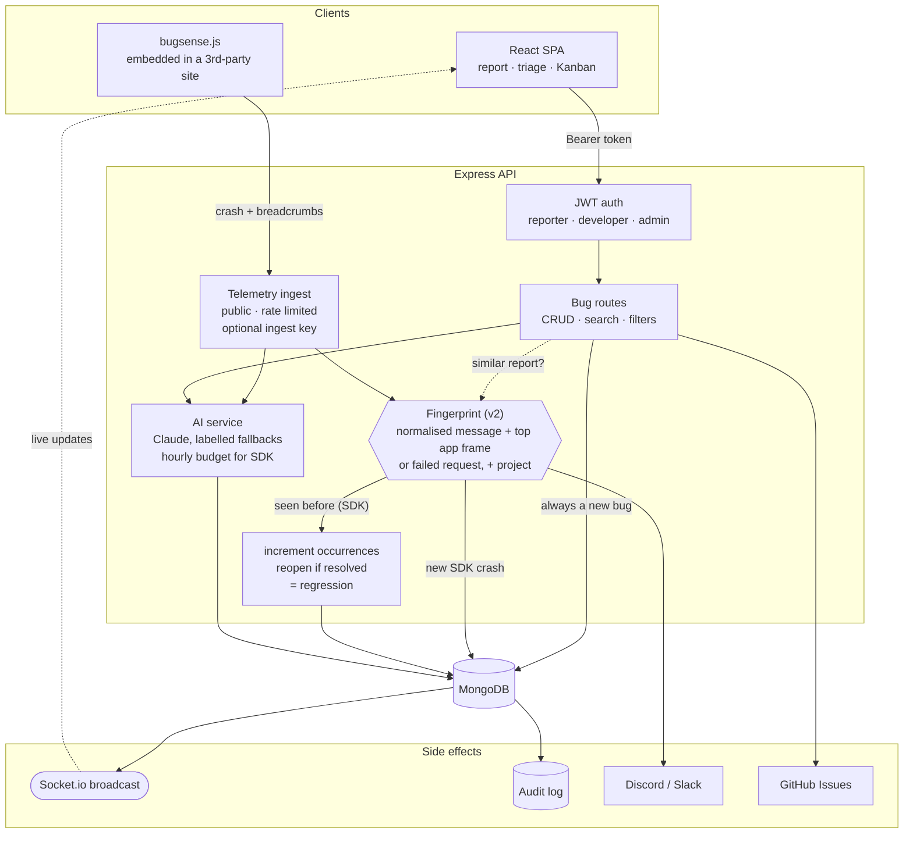

# Architecture & Engineering Decisions

How the pieces fit together, the decisions that shaped the code, and what it
does not do well.

---

## Architecture

Two ways in: a human filing a structured report, or an SDK in someone else's app
reporting a crash automatically. Both are fingerprinted, but only SDK crashes are
deduplicated — a person's report is always kept, with a "looks similar" hint.
Every write fans back out over authenticated WebSockets.

**The part worth reading the code for** is the fingerprint step. Each incoming
crash is reduced to a key: the error message with its data stripped and each
browser engine's wording of it mapped to one form, the top application stack
frame without its line and column (for a failed HTTP request, the endpoint
instead), and the project name. The key is hashed, so identical SDK crashes
collapse into one incident with an occurrence counter instead of a thousand
duplicate rows, and a crash that reappears after being marked resolved is
automatically flagged as a regression. This is the second version of the key
(v2), live since PR #7. See
[`fingerprint.util.js`](../server/utils/fingerprint.util.js) and
[`telemetry.controller.js`](../server/controllers/telemetry.controller.js).

Only the first version (v1) has been measured.
[`docs/fingerprint-results.md`](fingerprint-results.md) reports a
pre-registered evaluation of v1 against a 748-report corpus of real stack traces,
built blind from three browser engines: identical repeats grouped reliably — the
crash-loop case this exists for — while grouping the same bug across browsers and
across minified production builds did not. v1 read stack frames only in
Chromium's format, so Firefox and Safari reports were keyed with no error message.
v2 parses all three engines' stacks and reproduces its pre-registered predictions
on the v1 corpus, but that is the corpus it was designed against: no measurement
on held-out data has been made.
[`docs/fingerprint-results-v2.md`](fingerprint-results-v2.md) separates what was
verified from what was not.

---

## Engineering Decisions

The choices below shaped the code most. Each one records what was done, why, and
what it costs.

**Only machine reports are deduplicated.** Merging two SDK crashes loses nothing,
because they're the same stack trace. Merging two *human* reports throws away
someone's description and steps, so manual reports are always kept and the
reporter is shown the similar incident instead.

**Deduplication is race-safe by construction.** A crash loop can send many
identical reports at once. Counting uses a single atomic `$inc`, and a unique
partial index on `{fingerprint, source: 'sdk'}` means two simultaneous "first"
reports can't both create an incident — the loser gets a duplicate-key error and
is retried as a repeat. A regression is flipped with one conditional update, so
it's recorded exactly once. The API tests fire eight reports concurrently to
prove it.

**Rich text is sanitised twice.** Descriptions are cleaned with `sanitize-html` on
write and with DOMPurify before rendering. The server copy protects every
consumer of the API; the client copy also covers records stored before
sanitising existed. This matters more than usual because the JWT lives in
`localStorage` (a project requirement): any script injection could read it. An
`httpOnly` cookie would be the stronger choice in a real deployment.

**Sessions can be revoked.** Each user has a `tokenVersion` embedded in their JWT.
Changing a password increments it, which invalidates every other session
immediately without keeping a server-side token list.

**The public endpoint is treated as hostile.** `/api/telemetry/report` must accept
unauthenticated traffic from other origins, so it has its own CORS policy, a
64 KB body limit, per-field length caps, enum coercion, its own rate limit and an
optional shared ingest key. Each new crash triggers an AI analysis, so those are
capped per hour — otherwise anyone could run up the API bill. Reports cannot claim
`critical` priority or `blocker` severity either: those page every alert channel,
so an SDK report tops out at high/major and staff escalate it after triage.

**Nothing waits on the model.** Filing a bug with an error log returns at once;
the analysis runs in the background (with its own hourly budget) and arrives on
the bug page over the socket. A generated patch is saved and reopened for free,
and only regenerated on request.

**AI output always says where it came from.** Every result the API returns
carries `source` (`claude`, `heuristic`, `template` or `unavailable`) and the UI
labels it. A saved patch is the one stored result without it: the server saves a
patch on the bug only when `source` is `claude`
([`ai.controller.js`](../server/controllers/ai.controller.js)), so `gitPatch`
stores no `source`, and the client labels any saved patch as Claude's on that
basis. Without
an API key, patch generation returns nothing rather than an invented diff: a
plausible-looking fake patch is worse than none.

**Two payload shapes, both populated.** Viewers of a bug receive the same fully
populated document as `GET /bugs/:id`, so they can replace their copy without
losing names or history. Everyone else gets the slim list shape that `GET /bugs`
returns — a crash loop re-broadcasts its bug on every occurrence, and each copy
would otherwise carry the full error log and breadcrumbs to every open tab.
Sockets require the same JWT as the REST API.

**Permissions live on the server; the UI mirrors them.** Every mutating route checks
the role or ownership (`authorize()`, `canModifyBug()`, `canSetStatus()`); the
client hides controls the user can't use, but never relies on that for security.
Being staff is a deliberate grant: developer self-sign-up is off in production
unless `ALLOW_DEVELOPER_SIGNUP=true`, and the server's GitHub token only files
issues in repositories listed in `GITHUB_ALLOWED_REPOS`.

**Unsafe configuration fails loudly.** Unless `NODE_ENV` is explicitly
`development` or `test`, the server refuses to start with a missing, published or
short `JWT_SECRET`. An unset `NODE_ENV` counts as production here, so a host that
forgets it cannot fall back to the built-in development secret, which is public
in this repository. The Docker quick start runs with
a public demo secret only because it sets `ALLOW_INSECURE_JWT_SECRET=true`, and
the server prints a warning banner when it does.

**Testable by design.** The Express app is built by `createApp()` in `app.js`,
separate from the process that listens and connects to the database, so the API
tests run the real middleware stack against an in-memory MongoDB.

## Known limitations

- Uploads default to the server's local disk, which hosts like Render and Railway
  wipe on every redeploy. Set `CLOUDINARY_URL` to keep them in Cloudinary instead.
- The AI budgets and rate limits are per process, not shared across instances
  (a Redis store would fix this).
- Search is a case-insensitive substring match, so "saf" finds "Safari" as you
  type, but it scans rather than using an index. Queries are capped at 5 seconds;
  at real scale this would move to Atlas Search (a plain MongoDB text index only
  matches whole words).
- Single workspace: every signed-in user can see every bug.
- No email verification or password reset flow.
- No telemetry metric can be broken down by time. The SDK pipeline records how
  many times each incident occurred (one atomic `occurrences` counter) but not
  when each crash arrived — only the first and last. So crash rates, crashes per
  day, or "deduplication today" cannot be derived from stored data; the Overview
  shows the deduplication pair as all-time totals for this reason. Supporting
  them would mean recording arrivals, e.g. a per-incident daily bucket
  incremented alongside `occurrences`, and would only cover crashes received
  after that change.
- **Dependency advisories (reviewed 2026-11-05).** `npm audit --omit=dev` is
  clean in `server/`. The full audit reports 2 moderate dev-only entries there,
  both the same **minimatch** advisory through nodemon, and 2 low entries in
  `client/`, both the same root advisory; both are accepted below. CI runs
  `npm audit` on every push and
  weekly; see `.github/workflows/ci.yml` for the thresholds.
  - *Fixed on 2026-11-05*, by `npm audit fix` within existing semver ranges,
    after the weekly run of 2 November failed on an unchanged lockfile:
    - Server runtime: **qs** 6.16.2 (moderate, an uncaught TypeError (DoS) in
      `qs.stringify` with `arrayFormat: 'comma'`), through **express** 4.22.3,
      which now declares `~6.16.0` itself. The `overrides` entry for qs moves
      from `^6.16.0` to `~6.16.1`: the floor is the fixed release, and the caret
      would have pulled in 6.17, which changes how `qs.parse` treats prototype
      keys and array limits, and Express runs that parser on every query
      string. Not reachable before the fix: express and body-parser only call
      `qs.parse`; `qs.stringify` is used by superagent, through Supertest.
    - Both packages: **follow-redirects** 1.16.2 (high, cross-realm
      `sensitiveHeaders` arrays discarded and custom credentials kept across
      redirects). Not reachable, for the reasons given for 1.16.1 below: axios's
      `browser` field replaces its Node adapter, the only importer, with an
      empty module.
    - Dev-only: **minimatch** moved from 10.2.5 to 10.2.6 as a side effect;
      that is still inside the advisory range.
  - *Fixed on 2026-10-27*, within existing semver ranges: server runtime
    **multer** 2.5.0 (high, DoS through a pending asynchronous file filter after
    the request is torn down) and **body-parser** 1.20.9 (high, DoS through
    trailing bytes after a compressed body); client dev-only **undici** 7.30.1
    (through jsdom), **zod** 4.6.7 (through eslint-plugin-react-hooks) and
    **postcss-selector-parser** 6.1.5 (through Tailwind 3; the fix was backported
    to 6.x, so no Tailwind 4 migration was needed). **braces** is still 3.0.3,
    through nodemon and Tailwind, but `npm audit` no longer reports it; it was
    accepted before, as dev-only and fed only our own glob patterns.
  - *Fixed on 2026-10-23*, all within existing semver ranges:
    - Server runtime: **proxy-addr** 2.0.8 (critical, IP spoofing through a
      mis-written IPv6 trust subnet), **engine.io** 6.6.11 (high, an
      unauthenticated client could crash the process during the Socket.io
      transport upgrade), **sanitize-html** 2.18.1 (moderate, three XSS
      bypasses), **ip-address** 10.7.4 (moderate, DoS and a cross-family subnet
      check, reached through express-rate-limit) and **source-map-js** 1.2.2
      (high, DoS, reached through sanitize-html's CSS parser).
    - Of these, only engine.io was exploitable in the shipped configuration. The
      proxy-addr bug needs `TRUST_PROXY` set to an address list (a supported
      option; see [CONFIGURATION.md](CONFIGURATION.md)) containing an
      IPv4-mapped or zero-prefix IPv6 range such as `::ffff:10.0.0.0/8`. The
      default hop count and correctly written lists were never affected, but
      the parser does not validate lists, so a mis-written range would have
      been exploitable before 2.0.8. The sanitize-html bypasses, and the
      source-map-js path, need a `noscript`, `svg`, `meta` or `style` that our
      allowlist strips; a unit test (`neutralises the sanitize-html,
      source-map-js and quill advisory payloads`) pins that. express-rate-limit checks `net.isIPv6()` before it parses an
      address, which rejects the oversized and multi-`%` inputs.
    - Dev-only: **vite** 8.3.5 (dev-server file exposure and `launch-editor`
      command injection on Windows), **vitest** and **@vitest/coverage-v8**
      5.0.5 (mock-registration code injection), **brace-expansion** 1.1.21
      (DoS, via ESLint).
    - Not reachable either way: **follow-redirects** 1.16.1 (high, credential
      headers kept across cross-origin redirects). The server copy is dev-only,
      used by mongodb-memory-server to download the test database. The client
      copy is a runtime dependency of axios but is used only by axios's Node
      adapter, which Vite leaves out of the browser bundle.
  - *Accepted, re-checked on 2026-11-05.* **quill** 2.0.3 (low, XSS in its HTML
    export, CVE-2025-15056), through react-quill-new: 2 entries.
    - The flaw: the formula and video embeds' `html()` put their values into
      the `getSemanticHTML()` output without escaping. BugSense uses that path:
      react-quill-new builds the editor's `onChange` value with
      `getSemanticHTML()`, and that string is what the bug form submits.
    - Formula embeds cannot be created, because BugSense does not load KaTeX.
      Video embeds can. The toolbar has no button for them, but the editor has
      no `formats` allowlist, so a pasted `<iframe class="ql-video">` becomes
      one, and its exported HTML carries the injected attribute.
    - Not exploitable: both published payloads (`` and `https://example.com" onmouseover="alert(1)`)
      were exported from the installed Quill under jsdom, then passed through
      `sanitizeRichText` and the client's DOMPurify config. Neither result has
      an event handler, an `img` or an `iframe`. DOMPurify alone also drops the
      handlers, which covers rows stored before server sanitizing. Both
      exported strings are pinned: the server's advisory-payloads unit test
      runs them through `sanitizeRichText`, and a client test runs them through
      DOMPurify alone; each fails if an event handler survives.
    - No fixed version exists: quill 2.0.3 is the latest, and react-quill-new
      3.8.3, the latest, requires `~2.0.3`. The `--force` suggestion downgrades
      react-quill-new to 3.7.0, which resolves quill 2.0.2, whose formula and
      video `html()` are identical. It leaves the listed range without fixing
      anything.
  - *Accepted on 2026-11-05.* **minimatch** 10.2.6 (moderate, DoS through
    globparts amplification, GHSA-g3hv-75wg-m249), dev-only, through nodemon:
    2 entries.
    - No upgrade path: the fix is in minimatch 11.0.1, but nodemon 3.1.14, the
      latest, requires `^10.2.1`. The only way to clear it is a downgrade:
      nodemon 3.1.11 (November 2025) depends on minimatch 3.x, outside the
      affected range. Pinning a dev tool to an older release to clear a
      dev-only advisory is not worth it.
    - Not reachable in anything BugSense ships: nodemon only runs `npm run dev`
      on a developer's machine, the server image installs with
      `npm ci --omit=dev`, and the patterns minimatch matches are nodemon's
      own watch defaults (there is no nodemon config), not user input.
    - It fails neither CI gate: the runtime audit omits dev dependencies, and
      the full audit fails only on critical.
- An SDK embedded from another origin without `crossorigin="anonymous"` misses
  unhandled fetch failures in Chromium-based browsers. The SDK calls the native
  `fetch` for the page, so the error is created inside the SDK's script; when
  that script is loaded without CORS, Chromium treats it as opaque and fires no
  `unhandledrejection` event at all (the console still shows the error).
  Firefox reports these failures either way. The server now sends
  `Access-Control-Allow-Origin: *` on `/sdk/` and the snippet carries the
  attribute, but embeds already in place stay blind in Chromium until their
  owner adds it. The SDK logs one console warning when it finds itself loaded
  this way. Unhandled rejections from the page's own code are unaffected.
- Chromium reports nothing for a rejection whose error object the browser itself
  created. For example, `response.json()` on an HTML error page rejects with a
  `SyntaxError`, and Chromium fires no `unhandledrejection` event for it, with
  or without the SDK on the page. The same `SyntaxError` thrown by `JSON.parse`
  in the page's own code is reported. Firefox and WebKit report both. No
  reporter that listens for `unhandledrejection` can see this class of error in
  Chromium, and the `crossorigin` attribute does not change it. Observed in
  Chromium 156: see
  [docs/fingerprint-results-v2.md](fingerprint-results-v2.md#61-chromium-dispatches-no-unhandledrejection-for-errors-the-browser-itself-creates).
- React 18 development builds report a render error caught by an error
  boundary twice. React dispatches a window `error` event as well as the
  boundary's `captureError` call. This happens identically in Chromium, Firefox
  and WebKit, so it is the build, not the engine. Occurrence counts for these
  errors are doubled in development and unaffected in production builds. See
  [docs/fingerprint-results-v2.md](fingerprint-results-v2.md#62-react-18-development-builds-report-one-error-twice).
- Grouping, as measured for v1. The five points below are v1's results. v2
  changes the key behind each of them, but none of those changes has been
  measured on held-out data, so they are not shown here as fixed.
- v1 grouped two different errors that shared their top stack frames — for
  example two different failing API calls, where the top frames are all inside
  axios — into one bug: 9 unrelated pairs of errors were merged, plus 9 of 15
  pairs that were designed to look alike. v2 skips library frames and keys failed
  HTTP requests on their endpoint, but ignores the page route by design, so its
  pre-registration expects at least three look-alike pairs to stay merged
  ([fingerprint-eval-v2.md §4.1](fingerprint-eval-v2.md#41-hard-negative-merges-at-least-three-pairs-cannot-be-separated)).
- v1 often did not group the same error across browsers: the three engines word
  the same `TypeError` differently, and only 27% of same-bug pairs that differ
  only by browser were grouped. v2 parses all three engines' stacks and maps
  their wordings to one form; a test pins one error from three engines getting
  one key.
- In a production (minified) build, a release that shifted line numbers and
  chunk hashes re-opened bugs that were still happening under v1: only 20% of
  same-bug pairs survived a release, against 91% in an unminified build. v2
  strips chunk hashes, but a minifier that renames the top function still splits
  the bug; its pre-registration expects this gate to fail
  ([§4.2](fingerprint-eval-v2.md#42-version-only-recall-in-production-builds)).
- Under v1, an error whose message embeds a value — a product id, a parsed
  string — could produce a separate bug per value: 12 of 20 such pairs were not
  grouped. v2 replaces digits, URLs and double-quoted values in messages, but
  keeps single-quoted ones.
- In Chrome, unhandled `fetch()` network failures are not reported at all, so they
  never reach grouping.
  - *Note, 2026-10-21:* PR #6 (merged 2026-10-21) added
    `crossorigin="anonymous"` to the embed snippet and made the server send
    `Access-Control-Allow-Origin: *` for the SDK script. This changes the
    behaviour for the reports that fix covers: fetch network failures that pass
    through the SDK's fetch wrapper are reported in Chromium when the SDK is
    embedded with the attribute. Errors the browser creates itself are not
    covered (see the `response.json()` limitation above). The bullet's original
    text is kept because it records what the v1 measurement found at the time.

The v1 numbers come from a pre-registered measurement: see
[docs/fingerprint-results.md](fingerprint-results.md). What was and was not
verified for v2 is in [docs/fingerprint-results-v2.md](fingerprint-results-v2.md).
The corpus and
harness are at [bugsense-eval](https://github.com/Krishnendu-9/bugsense-eval).
